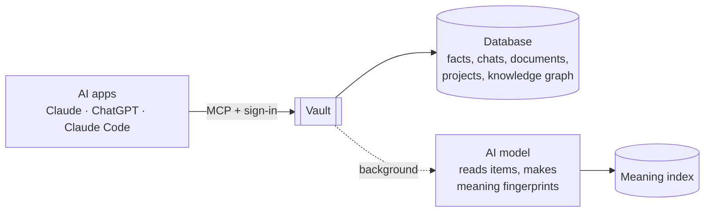
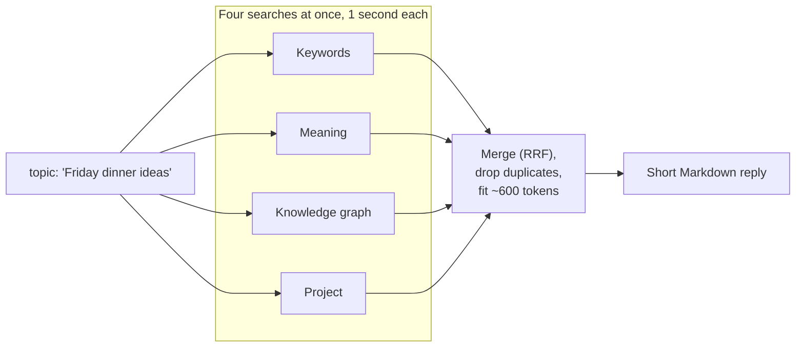

# How Vault works

Vault is one small program. Every AI app talks to it the same way: over MCP at `/mcp`, after a
sign-in. This page shows what happens when an app **saves** something and when it **asks**, then
the rules behind it and why each choice was made.



| Part | On Cloudflare | On any computer |
|---|---|---|
| Server | Worker + one Durable Object session per app | a Node program (or Docker) |
| Database | D1 | one SQLite file |
| AI model | Workers AI (`llama-3.3-70b` for the graph, `bge-m3` for meaning) | any OpenAI-style service, e.g. Ollama |
| Meaning index | Vectorize | a second SQLite file |
| Sign-in | Google or any OpenID Connect service | a secret key, the same sign-in page, or both |

## A save

1. **Write and reply.** The item is written in one database batch and the app gets "Saved ✓" at
   once. The chat never waits for the AI.
2. **Knowledge graph (background).** An AI model reads the item and lists the people, places and
   things in it and how they connect (*Me → prefers → Margherita*, *Margherita → is a → food*).
   Plain code checks every link before storing it (see the rules below).
3. **Meaning fingerprint (background).** The item is turned into numbers that capture its meaning
   (long items in pieces of about 1,500 characters), so "what food do I like?" finds "margherita".
4. **If a background step fails** (model down, free allowance used up), the save still stands. The
   failure is logged in `graph_log` and a [catch-up](setup.md#catch-up) fills the gap later.

Updates and forgets take the same path: the old version's links and fingerprints are switched off,
and the new version gets its own.

## A question (`get_context`)



1. **Four searches start together:** keywords (SQLite full-text search), meaning (the index),
   the knowledge graph (named people and things, everything filed under a named category, and
   links up to two steps away) and the project, if one is named.
2. **Each gets one second.** A slow or failed search is left out and named in the reply; the rest
   still answers.
3. **Results are merged** with Reciprocal Rank Fusion: a fact near the top of any list, or found by
   several, ranks higher.
4. **The reply is tidied and sent** as short Markdown lines, each fact with its id and date so the
   app can update or forget it:

```
## Facts
- id: 4821 · date: 2026-11-05 · fact: Favourite pizza is margherita
## Connections
- Me → prefers → Margherita
```

`search_history` does the same for old chats and documents (keywords and meaning together), and
returns each hit with the messages around it.

## The rules

- **Nothing is ever deleted or edited in place.** An update switches the old row off
  (`active = 0`) and adds a new one (`replaces_id` = old row) in one batch; "forget" only switches
  off. Database triggers refuse deletes and edits, so no app can lose data by mistake.
- **Newest wins, facts beat chats.** A one-value link (lives in, works at) is replaced only by
  information at least as new, and a chat or document never overrides a value that came from a fact.
- **The AI proposes, code decides.** The graph uses a fixed list of entity types (person, place,
  thing…), link types (lives_in, owns, prefers…) and 44 categories (car, laptop, food, trip…). Anything
  else is skipped and noted for review. The lists are in `src/graph/schema.ts`.
- **The server labels who saved what.** Each row's `source` (claude, chatgpt…) comes from the
  signed-in app, never from what the AI says.

The tables are built only by the numbered files in [`migrations/`](../migrations/): `0001` your data
(facts, profile, projects, chats, documents), `0002` the knowledge graph, `0003` the meaning-index
records.

## Why it's built this way

Each choice was tested against the exam where possible (see [`evals/`](../evals/README.md)).

| Choice | Why |
|---|---|
| **Look things up, don't train** | Training teaches style, not exact facts. Looking up facts at question time is exact and instantly current. |
| **One MCP endpoint for every app** | ChatGPT gained custom MCP connectors, so one set of tools and instructions serves every app with no per-app code. |
| **Free tier only** | A personal tool shouldn't need a bill. Free allowances became design limits ([limits](limits.md)). No scheduled jobs: everything happens on save or ask. |
| **Saves reply first** | The graph model takes 4–11 s. The chat waits only for the database write; the AI work follows in the background. |
| **Knowledge graph with fixed rules** | Keyword search can't link "my sister" to her name. The graph took nickname questions from 0% to 75%. Fixed rules stop old chats overwriting current facts. |
| **Meaning search, one model everywhere** | "car" must find "Fiat Panda". Fingerprints from different models can't be compared, so backfill and live saves use the same model. Recall went from 55% to 83%. |
| **Four searches merged with RRF** | Their scores aren't comparable; ranks are. No weights to tune. "Best answer near the top" rose from 0.09 to 0.88. |
| **Meaning cut-off 0.45** | Tried 0.40–0.55. A stricter rule for short questions lost answers every time, so it was dropped. |
| **Markdown replies, not JSON** | Published long-context tests rank JSON worst. Fewer tokens per fact meant more facts fit: recall 83% → 89%. |
| **One-second budget per search** | One slow part (a model waking up) never holds up the whole answer. |
| **Fixed categories** | "car hire" should reach every car. Free-form categories come out too broad or too narrow. Category questions went to 100%. |
| **Measured by an exam scored by fact id** | "Feels better" isn't evidence. Scoring by which facts come back is free and repeatable, and it caught a change that made things worse. |
| **A Node build on a SQLite file** | D1 is SQLite underneath, so a thin stand-in runs the same code anywhere, with nothing extra to install. |
| **Any OpenAI-style AI service** | One small file covers OpenAI, OpenRouter, Ollama, LM Studio and others, with no SDK. |
| **Meaning index in a SQLite file, searched exactly** | Nothing to install, and fast enough for tens of thousands of items. It can be rebuilt from the database at any time. |
| **Sign-in through any OpenID Connect service** | Google, Microsoft, Auth0, Okta, Keycloak and others all speak it. Only `ALLOWED_EMAIL` gets in, and the email must be verified. |
